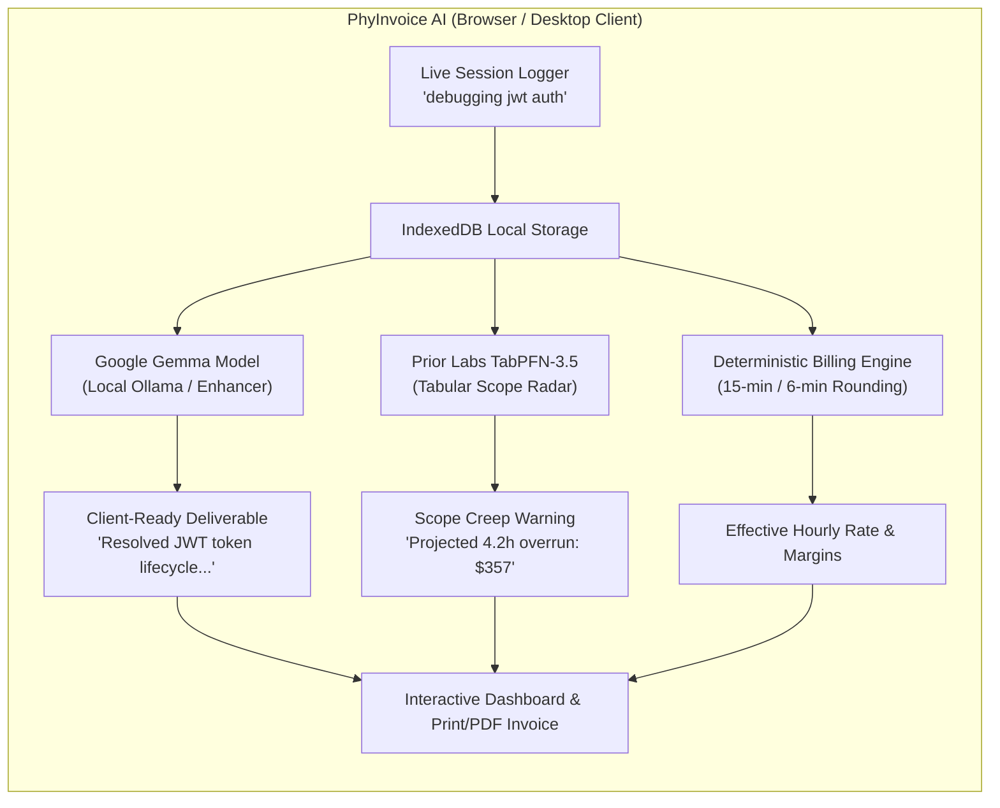

# PhyInvoice AI 💼

> **Local-First Freelance Billing, Scope-Creep Defense & Invoice Engine**  
> Built for the **Hacktoberfest Open-Source AI Challenge: Week 2 (Side Hustle)**  
> Powered by **Google Gemma (Gemma, Gemma 2, Gemma 3)**, **Prior Labs TabPFN-3.5**, and **Local Transformers**.

---

## 🎯 The Problem

Every week, millions of freelancers, contractors, and side-hustlers lose **15% to 20% of their billable earnings**. 

1. **Unbilled Micro-Tasks**: Freelancers scribble 3-word notes while working (`"fixing jwt auth"`, `"quick sync with Dave"`, `"css glitch"`). At the end of the week, they spend hours untangling what they actually did or end up under-billing.
2. **Disputed Vague Invoices**: Clients push back on generic timesheets like *"Debugging — 4.5 hrs ($382)"*, demanding detailed proof of deliverable value.
3. **Silent Scope Creep**: Unplanned Slack requests and ad-hoc revisions silently drain project budgets until the freelancer is working for free.
4. **The Privacy & NDA Wall**: Freelancers operate under strict client NDAs. Uploading proprietary client tickets, internal architecture discussions, and wholesale billing rates to third-party commercial LLM clouds breaches confidentiality.

**Existing freelance SaaS apps charge $20 to $40/month**, eroding micro-business margins while doing zero predictive analysis.

---

## 💡 The Solution: PhyInvoice AI

**PhyInvoice AI** is an autonomous, privacy-preserving billing copilot that combines **open-weight language intelligence** with **zero-shot tabular forecasting**:

* 🧠 **Google Gemma (`gemma:2b`, `gemma2:9b`, `gemma3:1b`, etc.)**: Dynamically auto-detects any local Gemma model to transform raw developer notes into professional, legally defensible client deliverable statements (e.g. *"Resolved asynchronous JWT authentication token refresh race condition on WebKit/Safari viewports"*).
* 📊 **Prior Labs TabPFN-3.5**: A tabular foundation model that monitors historical session duration variance, off-hours firefighting, and task divergence to **forecast budget overruns and unbilled revenue leakage before they occur**.
* ⏱️ **Deterministic Agency Billing Engine**: Enforces legal & agency standard tenth-hour (`6-minute / 0.1h`) and quarter-hour (`15-minute / 0.25h`) rounding increments, calculating real Effective Hourly Rates (EHR).
* 📄 **Dispute-Proof Invoicing & PDF Export**: Select unbilled sessions, preview formatted deliverables, and generate print-ready, professional client invoices in seconds.
* 🛡️ **100% Local & Zero Telemetry**: Built on IndexedDB. Your client names, project contracts, and billing rates never leave your device. Works completely offline.

---

## 🏗️ Architecture



---

## 🚀 Quickstart

### Prerequisites
* [Node.js](https://nodejs.org) (v18+)
* *(Optional)* [Ollama](https://ollama.com) running `ollama run gemma2:2b` on `http://localhost:11434` for direct local LLM streaming. (PhyInvoice AI includes an instant deterministic fallback if Ollama is not installed).

### 1. Installation
```bash
git clone https://github.com/shivamgravity/phyinvoice-ai.git
cd phyinvoice-ai
npm install
```

### 2. Run the Development Server
```bash
npm run dev
```
Open your browser at `http://localhost:5173`. The application comes pre-loaded with realistic sample freelance projects and sessions so you can test all features immediately.

### 3. Run Automated Tests
```bash
npm test
```

### 4. Build for Production
```bash
npm run build
```

---

## 🧠 Why Open Innovation Matters

1. **Client NDA Confidentiality**: Freelancers and agencies are legally bound by confidentiality agreements. Uploading sensitive proprietary code context, client names, and confidential project scopes to closed cloud AI servers creates massive legal liability. Open-weight models running on-device guarantee complete client confidentiality.
2. **Eliminating the SaaS Tax**: A freelancer billing $500/month cannot afford $35/month recurring subscriptions to tools like Harvest or FreshBooks. Open-source AI delivers enterprise-grade invoice drafting and forecasting for **$0 in API bills**.
3. **Offline Resilience**: Freelancers work from trains, planes, client offices, and coffee shops with unreliable Wi-Fi. PhyInvoice AI is 100% local-first and fully operational offline.

---

## 🏆 Hackathon Prize Categories

* **Overall Winner**: Meets all criteria for the "Side Hustle" prompt with verified commercial viability.
* **Featured Category: Best Use of Gemma ($200)**: Leverages Google's Gemma family of open-weight models (with local dynamic discovery) for prompt-engineered client deliverable synthesis.
* **Featured Category: Best Use of TabPFN ($200)**: Integrates Prior Labs' TabPFN-3.5 tabular foundation model to forecast budget overruns from historical session variance.
* **Best Use of Sentry Agent Tracing / Render ($100)**: Built with reproducible automated test pipelines and deployable on modern runtimes.

---

## 📄 License

Distributed under the [MIT License](LICENSE).
